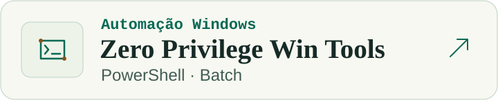
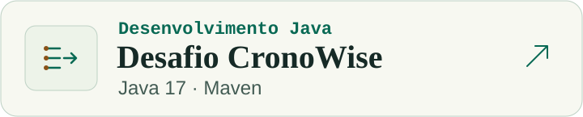
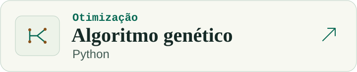

<h1>
<picture>
  <source media="(prefers-color-scheme: dark)" srcset="assets/hero-dark.svg">
  
</picture>
</h1>

Desenvolvo ferramentas de automação para Windows com PowerShell. Meus repositórios também reúnem projetos de desenvolvimento em Java e experimentos de algoritmos em Python.

## Projetos em destaque

<a href="https://github.com/KayssonGabriel/zero-privilege-win-tools">
<picture>
  <source media="(prefers-color-scheme: dark)" srcset="assets/zero-privilege-win-tools-dark.svg">
  
</picture>
</a>

Autoatendimento para tarefas de rede e manutenção do Windows em contexto de usuário.

<a href="https://github.com/KayssonGabriel/desafio-cronowise-kaysson-gabriel">
<picture>
  <source media="(prefers-color-scheme: dark)" srcset="assets/desafio-cronowise-kaysson-gabriel-dark.svg">
  
</picture>
</a>

Solução de um desafio técnico com fila de solicitações e detecção de anomalias.

<a href="https://github.com/KayssonGabriel/Algoritmo-Genetico-Mochila">
<picture>
  <source media="(prefers-color-scheme: dark)" srcset="assets/Algoritmo-Genetico-Mochila-dark.svg">
  
</picture>
</a>

Implementação de um algoritmo genético para explorar soluções do problema da mochila.

## Atividade pública

<picture>
  <source media="(prefers-color-scheme: dark)" srcset="assets/activity-dark.svg">
  
</picture>

**28 commits públicos** de dez/25 a nov/26 em projetos próprios.

<picture>
  <source media="(prefers-color-scheme: dark)" srcset="assets/languages-dark.svg">
  
</picture>

**51 repositórios próprios** · 1 fork público. Cada repositório próprio com linguagem identificada conta uma vez no gráfico.

Dados dos gráficos em texto

### Commits por mês

| Mês | Próprios | Forks da conta | Terceiros |
| --- | ---: | ---: | ---: |
| dez/2025 | 0 | 0 | 0 |
| jan/2026 | 0 | 0 | 0 |
| fev/2026 | 0 | 0 | 0 |
| mar/2026 | 0 | 0 | 0 |
| abr/2026 | 25 | 0 | 0 |
| mai/2026 | 3 | 0 | 0 |
| jun/2026 | 0 | 0 | 0 |
| jul/2026 | 0 | 0 | 0 |
| ago/2026 | 0 | 0 | 0 |
| set/2026 | 0 | 0 | 0 |
| out/2026 | 0 | 0 | 0 |
| nov/2026 | 0 | 0 | 0 |

### Linguagens por repositório

| Linguagem | Repositórios |
| --- | ---: |
| Java | 30 |
| C++ | 10 |
| JavaScript | 5 |
| Python | 4 |
| PowerShell | 2 |

[Repositórios públicos](https://github.com/KayssonGabriel?tab=repositories) · [Metodologia e manutenção](docs/manutencao.md)
