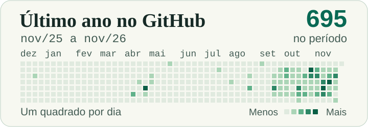

<h1>
<picture>
  <source media="(prefers-color-scheme: dark)" srcset="assets/hero-dark.svg">
  
</picture>
</h1>

## Contribuições

<picture>
  <source media="(prefers-color-scheme: dark)" srcset="assets/calendar-dark.svg">
  
</picture>

**693 contribuições** no calendário público do GitHub (nov/25 a nov/26).

Contribuições por mês em texto

| Mês | Contribuições |
| --- | ---: |
| nov/2025 | 0 |
| dez/2025 | 3 |
| jan/2026 | 0 |
| fev/2026 | 0 |
| mar/2026 | 0 |
| abr/2026 | 65 |
| mai/2026 | 6 |
| jun/2026 | 0 |
| jul/2026 | 2 |
| ago/2026 | 31 |
| set/2026 | 100 |
| out/2026 | 253 |
| nov/2026 | 233 |

Desenvolvo ferramentas de automação para Windows com PowerShell. Também exploro sistemas distribuídos em Node.js e concorrência em Java.

## Projetos em destaque

<a href="https://github.com/KayssonGabriel/SD_HUB-CD">
<picture>
  <source media="(prefers-color-scheme: dark)" srcset="assets/SD_HUB-CD-dark.svg">
  
</picture>
</a>

Protótipo que conecta centros de distribuição, consulta estoques e registra transações entre serviços.

<a href="https://github.com/KayssonGabriel/it-support-toolkit">
<picture>
  <source media="(prefers-color-scheme: dark)" srcset="assets/it-support-toolkit-dark.svg">
  
</picture>
</a>

Ferramentas modulares para manutenção de rede, impressão e drivers no Windows, com logs de execução.

<a href="https://github.com/KayssonGabriel/Simuladores-Leitores-Escritores-SO">
<picture>
  <source media="(prefers-color-scheme: dark)" srcset="assets/Simuladores-Leitores-Escritores-SO-dark.svg">
  
</picture>
</a>

Cinco abordagens para coordenar leitores e escritores sobre um recurso compartilhado, de semáforos à troca de mensagens.

## Commits públicos

<picture>
  <source media="(prefers-color-scheme: dark)" srcset="assets/activity-dark.svg">
  
</picture>

**28 commits públicos** de dez/25 a nov/26 em projetos próprios.

Commits por mês em texto

| Mês | Próprios | Forks da conta | Terceiros |
| --- | ---: | ---: | ---: |
| dez/2025 | 0 | 0 | 0 |
| jan/2026 | 0 | 0 | 0 |
| fev/2026 | 0 | 0 | 0 |
| mar/2026 | 0 | 0 | 0 |
| abr/2026 | 25 | 0 | 0 |
| mai/2026 | 3 | 0 | 0 |
| jun/2026 | 0 | 0 | 0 |
| jul/2026 | 0 | 0 | 0 |
| ago/2026 | 0 | 0 | 0 |
| set/2026 | 0 | 0 | 0 |
| out/2026 | 0 | 0 | 0 |
| nov/2026 | 0 | 0 | 0 |

## Linguagens

<picture>
  <source media="(prefers-color-scheme: dark)" srcset="assets/languages-dark.svg">
  
</picture>

**51 repositórios próprios** · 1 fork público. Cada repositório próprio com linguagem identificada conta uma vez no gráfico.

Linguagens por repositório em texto

| Linguagem | Repositórios |
| --- | ---: |
| Java | 30 |
| C++ | 10 |
| JavaScript | 5 |
| Python | 4 |
| PowerShell | 2 |

[Repositórios públicos](https://github.com/KayssonGabriel?tab=repositories) · [Metodologia e manutenção](docs/manutencao.md)
