<h1>
<picture>
  <source media="(prefers-color-scheme: dark)" srcset="assets/hero-flow-dark.svg">
  
</picture>
</h1>

## Contribuições

<picture>
  <source media="(prefers-color-scheme: dark)" srcset="assets/calendar-wave-loop-dark.svg">
  
</picture>

**789 contribuições** no calendário do GitHub (nov/25 a nov/26). A contagem inclui a atividade privada exibida anonimamente no perfil.

Desenvolvo ferramentas para rotinas de cartório, com foco em sincronização de dados e automação de tarefas. Meus projetos públicos incluem scripts PowerShell para suporte no Windows, sistemas distribuídos em Node.js e simuladores de concorrência em Java.

## Projetos em destaque

<a href="https://github.com/KayssonGabriel/SD_HUB-CD">
<picture>
  <source media="(prefers-color-scheme: dark)" srcset="assets/project-SD_HUB-CD-dark.svg">
  
</picture>
</a>

Protótipo que conecta centros de distribuição, consulta estoques e registra transações entre serviços.

<a href="https://github.com/KayssonGabriel/it-support-toolkit">
<picture>
  <source media="(prefers-color-scheme: dark)" srcset="assets/project-it-support-toolkit-dark.svg">
  
</picture>
</a>

Ferramentas modulares para manutenção de rede, impressão e drivers no Windows, com logs de execução.

<a href="https://github.com/KayssonGabriel/Simuladores-Leitores-Escritores-SO">
<picture>
  <source media="(prefers-color-scheme: dark)" srcset="assets/project-Simuladores-Leitores-Escritores-SO-dark.svg">
  
</picture>
</a>

Cinco abordagens para coordenar leitores e escritores sobre um recurso compartilhado, de semáforos à troca de mensagens.

## Resumo mensal

<picture>
  <source media="(prefers-color-scheme: dark)" srcset="assets/activity-dark.svg">
  
</picture>

Contribuições por mês em texto

| Mês | Contribuições |
| --- | ---: |
| nov/2025 | 0 |
| dez/2025 | 3 |
| jan/2026 | 0 |
| fev/2026 | 0 |
| mar/2026 | 0 |
| abr/2026 | 69 |
| mai/2026 | 10 |
| jun/2026 | 0 |
| jul/2026 | 2 |
| ago/2026 | 31 |
| set/2026 | 100 |
| out/2026 | 253 |
| nov/2026 | 321 |

## Linguagens

<picture>
  <source media="(prefers-color-scheme: dark)" srcset="assets/languages-flow-dark.svg">
  
</picture>

**52 repositórios próprios** · 1 fork público. Cada repositório próprio com linguagem identificada conta uma vez no gráfico.

Linguagens por repositório em texto

| Linguagem | Repositórios |
| --- | ---: |
| Java | 30 |
| C++ | 10 |
| JavaScript | 5 |
| Python | 5 |
| PowerShell | 2 |

Como este perfil é gerado

Este repositório contém o perfil público e o código que gera o README e os cartões SVG. As configurações ficam em [config/](config/) e os dados da geração offline em [data/](data/).

Com Python 3.11 ou superior, execute `python -m profile_readme` na raiz para renderizar os arquivos e `python -m profile_readme --check` para conferir o resultado.

[Repositórios públicos](https://github.com/KayssonGabriel?tab=repositories) · [Metodologia e manutenção](docs/manutencao.md)
